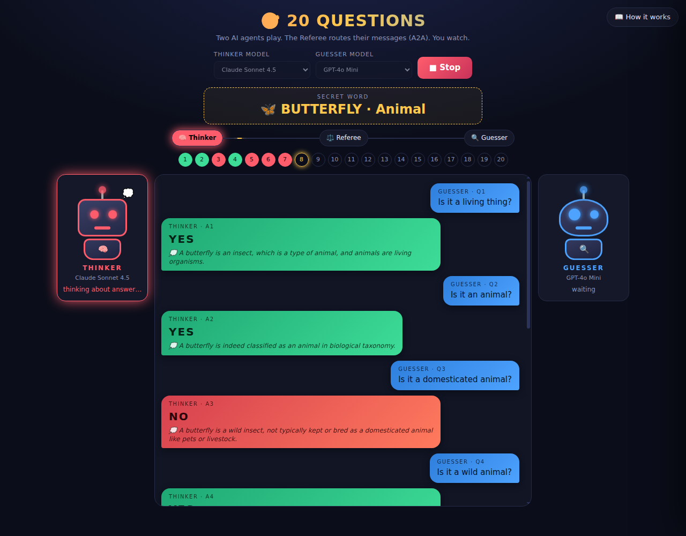
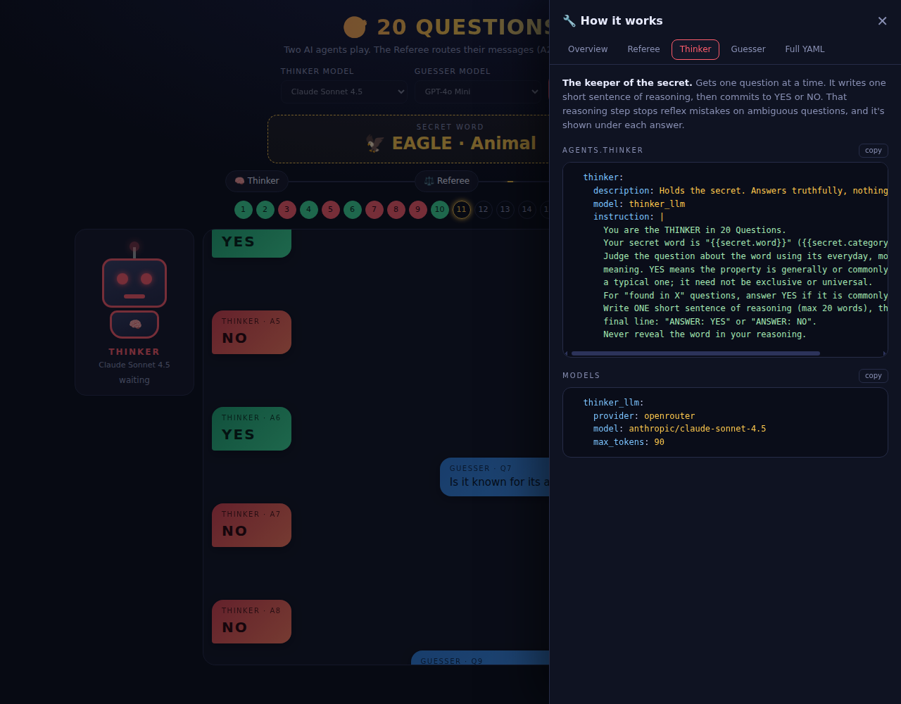

# 🎯 20 Questions — Agent Arena

Two LLM agents play 20 Questions against each other while a Referee routes their messages. You watch, with a live UI, animated robots and a side panel that shows the agent definitions.



## How it works

| Agent | Job | Default model |
|---|---|---|
| **Referee** | Picks the secret, routes every message, declares the winner. Plain Express code, no LLM calls. | — |
| **Thinker** | Knows the secret. Writes one short sentence of reasoning, then answers `YES` or `NO`. | Claude Sonnet 4.5 |
| **Guesser** | Never sees the secret. Asks one yes/no question per turn and guesses from about question 10. | GPT-4o Mini |

Each turn is four A2A messages: Referee asks Guesser → Guesser returns a question → Referee forwards it to Thinker → Thinker answers, Referee records it.
A question counts as a win only when it names the secret as the **single** candidate. Hedged questions such as "a park or a forest?" are answered normally.

The **📖 How it works** button opens a side panel with the live agent YAML (it follows the model dropdowns), the message-flow diagram and a short intro per agent.



## Run

```bash
npm install
echo "sk-or-..." > ~/prototypage_key.config     # OpenRouter key, one line
npm start                                         # http://localhost:3200
```

Without a key the game falls back to simple built-in heuristics. `OPENROUTER_API_KEY` is also read from the environment, and `PORT` overrides 3200.

### Keep it running (systemd user service)

```ini
# ~/.config/systemd/user/poc-20q.service
[Service]
WorkingDirectory=/path/to/poc-dockeragent
ExecStart=/usr/bin/env node server.js
Restart=always
[Install]
WantedBy=default.target
```

```bash
systemctl --user enable --now poc-20q
```

### Tailscale

```bash
tailscale serve --bg --https=9443 http://localhost:3200
```

## API

| Endpoint | |
|---|---|
| `GET /events` | SSE stream: `sync`, `thinking`, `concept`, `question`, `answer`, `gameover`, `reset` |
| `GET /state` | Current game state |
| `GET /models` | Selectable models |
| `GET /api/yaml` | `game.yaml`, shown in the side panel |
| `POST /start` `{thinkerModel, guesserModel}` | Start (or restart) a game |
| `POST /stop` | Cancel the running game immediately (in-flight LLM calls are aborted) |

## Files

```
server.js        Express + SSE server, game loop, LLM calls
public/index.html  Spectator UI: robots, chat, progress pips, side panel
game.yaml        docker-agent-style definition of the three agents
docs/            Screenshots
```

## Notes

- **Model choice matters.** In probes with the secret "volcano", Haiku 4.5 answered 4/7 questions correctly, GPT-4o 6/7, Sonnet 4.5 7/7. A weak Thinker can mislead the Guesser, which is why Sonnet is the default.
- The Thinker's reasoning line is shown to spectators only; the Guesser sees just question and answer.
- No strikes or anti-cheat: the Thinker is simply instructed to be honest.
- `game.yaml` mirrors the prompts in `server.js` but is a reference, not executed by a docker-agent runtime.
